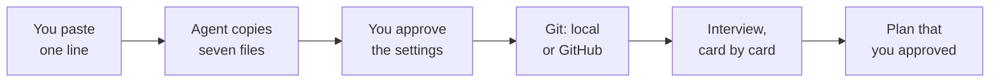
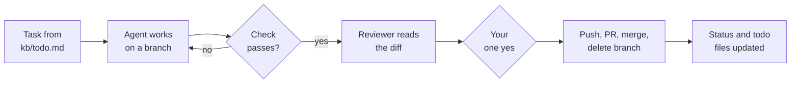
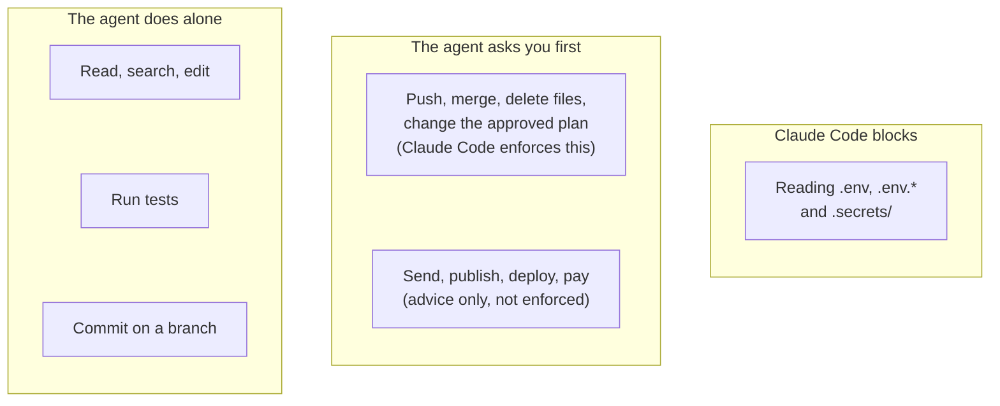
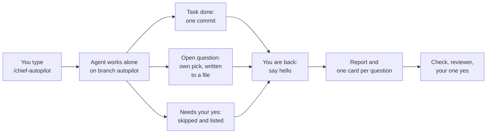

# The Chief Prompt

Last updated: 2026-11-13, with Claude Fable 5.2. See [CHANGELOG.md](CHANGELOG.md).

**Paste one line. One [Claude Code](https://code.claude.com) session becomes the chief of staff of your project, new or existing.**

- You talk to **one agent**. There is no team to manage.
- It **interviews you** until it can write a plan.
- It keeps its **memory in files**, not in the chat.
- It asks you for decisions in **short cards**.
- It asks you before it sends, publishes, deploys, pays, deletes, or merges for you. Claude Code enforces only a part of this: see "Who decides".

## Start

Paste this as your first message in the project:

```text
Clone https://github.com/MyNameIsGlooboo/chief-prompt to a temporary folder outside this project, read its template/SETUP.md, and do the steps in it. My language: simple English (A2).
```

Change the last sentence to your own language (for example "My language: simple Spanish."). If you name no language, the agent asks you.



The agent reads its steps from [`template/SETUP.md`](template/SETUP.md). When the plan is approved, open a new session.

**Project that already has files?** Paste this line instead. The prompt replaces none of your files:

```text
This project already has files. Run git status first, and if it shows work that is not committed, stop and ask me to commit it. Then clone https://github.com/MyNameIsGlooboo/chief-prompt to a temporary folder outside this project, read its template/SETUP.md, and do the steps in it. Replace none of my files. My language: simple English (A2).
```

Did you already talk in a session about the project? Read [the guide](docs/guide.md) first.

## How one task goes



The reviewer is a second, read-only agent. It reads code changes only. You say yes once for the whole last step.

## Who decides



## Autopilot

Away for some hours? Autopilot makes the agent work through `kb/todo.md` alone. You turn it on. It is never on by itself.



How to use it:

1. Check that `kb/todo.md` has open tasks and that all your work is committed.
2. Switch Claude Code to auto mode. A permission question from Claude Code stops the run until you answer, and auto mode asks the fewest.
3. Type `/chief-autopilot`. The agent tells you which tasks it will try and which it cannot do alone. Then you can go.
4. When you are back, say "hello", also in a new session. The agent shows you its report and asks one card per question.
5. Say yes or no to the `autopilot` branch, as for any other branch.

The agent does not push, merge, delete files, or change the approved plan in this mode. It does not send, publish, deploy, or pay. All of this is advice, and one run is one session. Read [the guide](docs/guide.md#autopilot) first.

## Each day

- **Start:** type `/clear` or open a new session, and say "hello". The state is in `CLAUDE.md`, `kb/status.md` and `kb/todo.md`, so the agent continues from "Next step".
- **Not sure?** Ask "Is everything saved?"

## Update

Is there a newer version of the prompt? Commit your work, then paste this line in the project:

```text
Clone https://github.com/MyNameIsGlooboo/chief-prompt to a temporary folder outside this project, read its template/.claude/skills/chief-update/SKILL.md, and do the steps in it.
```

The agent replaces the three files that the prompt owns and adds only the missing lines to your own files. It shows you `git diff` and waits for your yes. You can also type `/chief-update`, but the line always uses the newest steps. More in [the guide](docs/guide.md#update-a-project-to-a-newer-version-of-the-prompt).

## Five limits to know

1. **Most of it is advice.** The agent can drift from it. Only the rules in `.claude/settings.json` are enforced by Claude Code.
2. **You trust this repo.** The install line and the update line make the agent follow the steps on the main branch at that moment. Read [`template/SETUP.md`](template/SETUP.md) first if that matters to you.
3. **"Ask before sending, publishing, deploying, or paying" is not enforced.** Settings cannot catch these.
4. **The settings have holes.** A script that opens `.env` itself is not blocked, and `rm` is not the only way to delete a file.
5. **It is young.** It has not been tested over weeks of real use, or on a real project that already has files.

All limits are in [docs/limits.md](docs/limits.md).

## More

- [Guide](docs/guide.md): projects that already have files, what the agent copies, what you should see, updates, and what to do when a session ends.
- [All limits](docs/limits.md): what it does, and what it does not.
- [Why one agent, not many](docs/why-one-agent.md), with the sources.
- [For the maintainer](docs/maintainer.md): the check script and how this repo stays up to date.
- [Changelog](CHANGELOG.md)

## License

MIT. See [LICENSE](LICENSE). Not affiliated with Anthropic.
