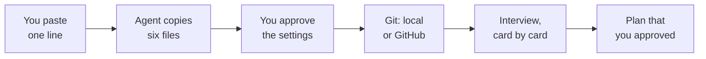
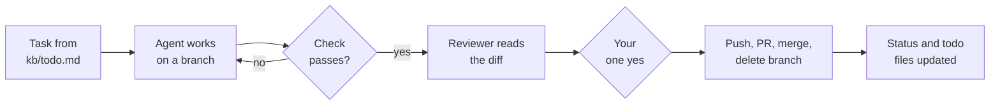
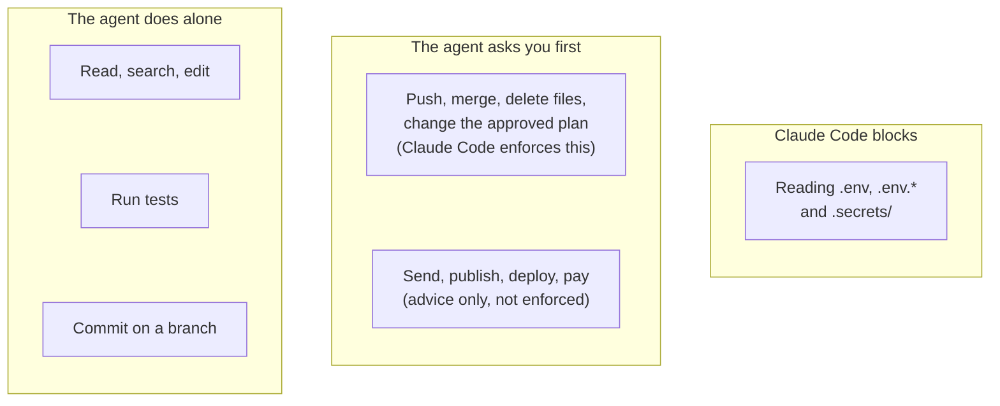

# The Chief Prompt

Last updated: 2026-11-13, with Claude Fable 5.2. See [CHANGELOG.md](CHANGELOG.md).

**Paste one line. One [Claude Code](https://code.claude.com) session becomes the chief of staff of your project, new or existing.**

- You talk to **one agent**. There is no team to manage.
- It **interviews you** until it can write a plan.
- It keeps its **memory in files**, not in the chat.
- It asks you for decisions in **short cards**.
- It never sends, publishes, deploys, pays, deletes, or merges for you without your approval.

## Start

Paste this as your first message in the project:

```text
Clone https://github.com/MyNameIsGlooboo/chief-prompt to a temporary folder outside this project, read its template/SETUP.md, and do the steps in it. My language: simple English (A2).
```

Change the last sentence to your own language (for example "My language: simple Spanish."). If you name no language, the agent asks you.



The agent reads its steps from [`template/SETUP.md`](template/SETUP.md). When the plan is approved, open a new session.

Does your project already have files, or did you already talk in a session? Read [the guide](docs/guide.md) first. The prompt replaces none of your files.

## How one task goes



The reviewer is a second, read-only agent. It reads code changes only. You say yes once for the whole last step.

## Who decides



## Each day

- **Start:** type `/clear` or open a new session, and say "hello". The state is in `CLAUDE.md`, `kb/status.md` and `kb/todo.md`, so the agent continues from "Next step".
- **Not sure?** Ask "Is everything saved?"
- **Newer version of the prompt:** type `/chief-update` in the project.

## Five limits to know

1. **Most of it is advice.** The agent can drift from it. Only the rules in `.claude/settings.json` are enforced by Claude Code.
2. **You trust this repo.** The one line makes the agent follow the steps on the main branch at that moment. Read [`template/SETUP.md`](template/SETUP.md) first if that matters to you.
3. **"Ask before sending, publishing, deploying, or paying" is not enforced.** Settings cannot catch these.
4. **The settings have holes.** A script that opens `.env` itself is not blocked, and `rm` is not the only way to delete a file.
5. **It is young.** It has not been tested over weeks of real use, or on a real project that already has files.

All limits are in [docs/limits.md](docs/limits.md).

## More

- [Guide](docs/guide.md): projects that already have files, what the agent copies, what you should see, updates, and what to do when a session ends.
- [All limits](docs/limits.md): what it does, and what it does not.
- [Why one agent, not many](docs/why-one-agent.md), with the sources.
- [For the maintainer](docs/maintainer.md): the check script and how this repo stays up to date.
- [Changelog](CHANGELOG.md)

## License

MIT. See [LICENSE](LICENSE). Not affiliated with Anthropic.
